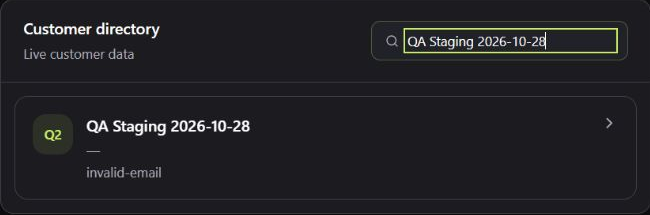

# QA-04 — Invalid email is accepted and persisted

**State:** Historical finding; current fix status not verified
**Environment:** Authenticated staging
**Observed:** 28 October 2026
**Evidence:** E01; original screenshot retained privately
**Classification:** Functional defect; P3

Reproduction: Customers → Add customer. Name `QA Staging 2026-10-28`, Email `invalid-email`, Create customer. The dialog closes and the customer directory and detail retain the invalid email.

Impact: unusable contact data can reach CRM and quotation email workflows. No email was sent during this test.

Source: `frontend/components/customers/AddCustomerModal.tsx:230` lacks an email input type; `backend/app/routes/customers.py:23` accepts an unconstrained optional string. Validate consistently in frontend and backend while retaining optional blank email support.

Evidence: `invalid-email-saved.png`.

## Retest acceptance

Repeat the original scenario on an identified deployed build, confirm the expected behavior, and run related negative and regression cases. Attach sanitized before/after evidence before closing. The source locations above refer to the historical snapshot and may have moved.

## Public screenshot excerpt

Original staging screenshot, cropped to the synthetic QA customer record. The saved value is `invalid-email`. Header identity and unrelated contacts are excluded.

